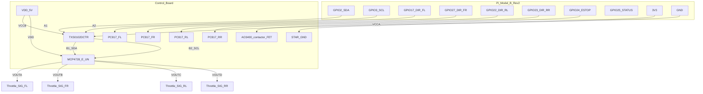

# Плата управления: MCP4728-E/UN + TXS0102DCTR + 4×PC817

Прототип под купленные чипы: **MCP4728-E/UN** (MSOP-10) и **TXS0102DCTR** (SSOP-8 / DCT).
Схема сверена с [docs/mcp4728.pdf](mcp4728.pdf) и [docs/txs0102.pdf](txs0102.pdf).

## Блок-схема



## Критично по даташитам (исправления)

| Было в старой схеме | По даташиту | Как правильно |
|---|---|---|
| TXS `VCCA` = 5 В, `VCCB` = 3.3 В | **VCCA ≤ 3.6 В**, **VCCB 2.3–5.5 В**, всегда **VCCA ≤ VCCB** | `VCCA` = **Pi 3.3 В**, `VCCB` = **5 В** |
| Pi на стороне B, DAC на стороне A | A-порт = низкий уровень, B-порт = высокий | Pi → **A1/A2**, MCP4728 → **B1/B2** |
| Внешние 4.7 кΩ обязательны | У TXS уже есть **внутренние 10 кΩ** на A и B | Внешние pull-up **не обязательны**; при необходимости — параллельно ≤10 кΩ |
| «Вывод VREF» у MCP4728 | У MCP4728-E/UN **нет вывода VREF** (только бит в регистре) | `VREF=0` → опорное = VDD → выход 0…5 В |
| Фильтр SIG **10 nF** | Max ёмкостная нагрузка VOUT = **1000 pF** | ≤ **1 nF** или без конденсатора (с series 100 Ω) |
| OE не указан | OE active-High, от VCCA; при power-up держать Low | OE → VCCA (или pulldown + enable после стабилизации питания) |

Заводские настройки MCP4728 EEPROM: адрес **A2A1A0=000 → 0x60**, но **VREF=1 (internal 2.048 V)**. После power-on без записи I2C выходы в диапазоне ~0…2.048 В. Драйвер при каждой записи выставляет **VREF=VDD** (и дополнительно шлёт команду Select VREF).

## Распиновка чипов

### TXS0102DCTR (DCT / SSOP-8)

| Pin | Имя | Куда |
|---|---|---|
| 1 | B2 | MCP4728 **SCL** |
| 2 | GND | STAR_GND |
| 3 | VCCA | Pi **3V3** + 100 nF к GND |
| 4 | A2 | Pi GPIO3 **SCL** |
| 5 | A1 | Pi GPIO2 **SDA** |
| 6 | OE | к **VCCA** (всегда ON) *или* 10 кΩ pulldown к GND + подтянуть к VCCA после power-up |
| 7 | VCCB | **VDD_5V** + 100 nF к GND |
| 8 | B1 | MCP4728 **SDA** |

### MCP4728-E/UN (MSOP-10)

| Pin | Имя | Куда |
|---|---|---|
| 1 | VDD | VDD_5V; bypass **100 nF** + **10 µF** к VSS (рекомендация Microchip) |
| 2 | SCL | TXS **B2** |
| 3 | SDA | TXS **B1** |
| 4 | LDAC | **VSS** (GND) — обновление VOUT сразу на ACK |
| 5 | RDY/BSY | float, если не используется; иначе **~100 кΩ** к VDD |
| 6 | VOUT A | SIG_FL (+ опц. 100 Ω series) |
| 7 | VOUT B | SIG_FR |
| 8 | VOUT C | SIG_RL |
| 9 | VOUT D | SIG_RR |
| 10 | VSS | STAR_GND |

## Схема по цепям

### 1. Питание логики

```
Buck 5V ──── VDD_5V ──── MCP4728 VDD
                      └── TXS0102 VCCB   (высокая сторона, 2.3…5.5 В)

Pi 3V3  ──── VDD_3V3 ─── TXS0102 VCCA   (низкая сторона, 1.65…3.6 В)
                      └── TXS0102 OE     (active High; см. выше)

Pi GND  ──── STAR_GND ── TXS GND, MCP4728 VSS, 4× throttle Black
```

Развязка:

- у **каждого** `VCCA` / `VCCB` / `VDD`: керамика **100 nF** максимально близко к выводам;
- у MCP4728 VDD дополнительно **10 µF** (tantalum/electrolytic) параллельно;
- на шине 5 В платы: bulk **10–47 µF**.

### 2. I2C (правильная полярность TXS)

```
Pi GPIO2 (SDA) ── TXS A1 ── B1 ── MCP4728 SDA
Pi GPIO3 (SCL) ── TXS A2 ── B2 ── MCP4728 SCL
Pi GND         ── TXS GND ── MCP4728 VSS

Pull-up: внутренние 10 кΩ TXS (A→VCCA, B→VCCB) + штатные ~1.8 кΩ на Pi к 3V3.
Внешние 4.7 кΩ к 5 В НЕ обязательны. Добавлять только если шина «тяжёлая»
и VOL ещё приемлемый (параллельно с внутренними 10 кΩ).

MCP4728 LDAC ── VSS (GND)
MCP4728 RDY/BSY ── NC (float) или 100 кΩ → VDD
```

Адрес I2C: **0x60** (`1 1 0 0 0 0 0`, A2A1A0=000 factory default).

Каналы:

| DAC | Колесо | Throttle SIG |
|---|---|---|
| VOUT A | FL | SIG_FL |
| VOUT B | FR | SIG_FR |
| VOUT C | RL | SIG_RL |
| VOUT D | RR | SIG_RR |

На каждый VOUT (опционально): **100 Ω** последовательно; при необходимости фильтра — конденсатор **≤ 1 nF** к GND **после** резистора (не 10 nF: лимит даташита 1000 pF).

Нагрузка throttle SIG контроллера обычно высокоомная (холл-вход) — это ок (Microchip: RL ≥ 5 кΩ желательно).

### 3. Реверс — PC817 ×4

```
GPIO17 ──[330 Ω]── PC817_FL anode
                    cathode ── STAR_GND

PC817_FL collector ── REV_FL_A  (провод reverse #1 контроллера FL)
PC817_FL emitter   ── REV_FL_B  (провод reverse #2 контроллера FL)
```

| GPIO | Оптопара | Колесо |
|---|---|---|
| 17 | PC817_FL | FL |
| 27 | PC817_FR | FR |
| 22 | PC817_RL | RL |
| 23 | PC817_RR | RR |

ПО: GPIO HIGH = reverse (замкнуто), LOW = forward.

### 4. E-STOP / контактор

```
GPIO24 ──[1k]── AO3400 / IRLZ44 gate
                 source ── STAR_GND
                 drain  ── катушка контактора (−)
Buck/12V_coil (+) ── катушка (+) ──[через NC E-STOP]── питание катушки

Параллельно катушке: 1N4007 (катод к +)
```

Boot: GPIO24 = LOW → контактор OFF. Arm только командой ПО.
GPIO25 — status LED (330 Ω).

## Разъёмы платы

| Разъём | Контакты |
|---|---|
| J_PI | 3V3, SDA, SCL, GPIO17/27/22/23/24/25, GND |
| J_TH_FL…RR | SIG, GND (Red +5V контроллера не подключать) |
| J_REV_FL…RR | пара reverse |
| J_ESTOP | к катушке / драйверу |
| J_5V | VDD_5V + GND от buck |

## BOM (логика I2C/DAC)

| Кол-во | Позиция | Примечание |
|---|---|---|
| 1 | **MCP4728-E/UN** | MSOP-10, адрес 0x60 |
| 1 | **TXS0102DCTR** | SSOP-8 DCT, VCCA=3.3 / VCCB=5 |
| 4 | PC817 | или 1× TLP281-4 |
| 4 | 330 Ω | LED оптопар |
| 1 | 10 кΩ | OE pulldown (если не вяжете OE напрямую к VCCA) |
| 1 | 1 кΩ | gate FET |
| 1 | AO3400 / 2N7000 / IRLZ44 | драйвер катушки |
| 1 | 1N4007 | flyback |
| 4 | 100 Ω | series на VOUT (опц.) |
| 4 | ≤1 nF | фильтр SIG (опц., не больше 1000 pF) |
| 3 | 100 nF | VCCA, VCCB, VDD |
| 1 | 10 µF | bulk у MCP4728 VDD |
| 1 | 10–47 µF / 10 В | bulk шины 5 В |
| 1 | LED + 330 Ω | status |
| 1 | 100 кΩ | RDY/BSY pull-up (если используете пин) |

Полный список: [bom.csv](bom.csv).

## Порядок сборки и smoke-test

1. Питание 5 В + GND, без Pi — проверить VDD у MCP4728.
2. Проверить **мультиметром**: TXS pin3 (VCCA) = 3.3 В, pin7 (VCCB) = 5 В. Не наоборот.
3. `i2cdetect -y 1` → `0x60`.
4. ПО: `arm` / выставить канал → измерить VOUT A: 0 / ~2.5 / ~5.0 В (после выбора VREF=VDD).
5. GPIO17 HIGH → прозвонка PC817 ≈ замкнуто.
6. Затем SIG/REV к контроллерам (колёса в воздухе).

## Включение I2C на Pi Model B Rev 2

```bash
sudo raspi-config   # Interface Options → I2C → Enable
sudo apt install -y i2c-tools
i2cdetect -y 1
```

На очень старых образах шина может быть `0` — смотрите `ls /dev/i2c-*`.
