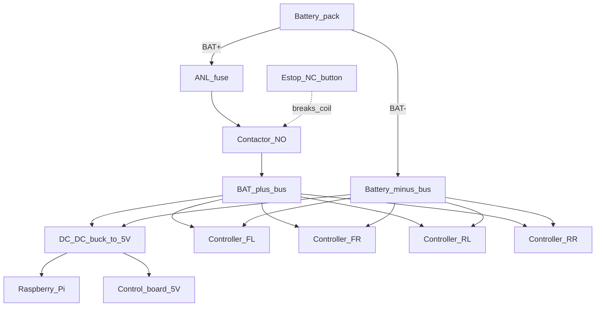

# Силовая часть: BAT bus, контактор, buck 5 В

## Топология



## Батарея

| Параметр | Рекомендация |
|---|---|
| Номинал | **48 / 60 / 72 В** — строго в диапазоне вашего Double Row 18 |
| Ток | 4× контроллера до ~45–60 А каждый → запас шины и BMS по **пику**, не по среднему |
| Сечение BAT+/BAT− | ориентир **16–35 мм²** на общую шину; отводы к каждому контроллеру по току фазы |
| Предохранитель | ANL/MEGA у батареи, номинал чуть выше ожидаемого пика пакета |

Точные амперы — после измерения на стенде; до этого не гонять полную тягу.

## Контактор и E-STOP

1. **Нормально разомкнутый** контактор (или силовое реле) на `BAT+` **после** предохранителя.
2. Катушка контактора: 12 В (или по паспорту) от отдельного buck **или** от вспомогательного выхода.
3. Драйвер катушки — FET с платы управления (GPIO24), см. [control_board.md](control_board.md).
4. Кнопка **E-STOP NC** в разрыв катушки: физическое отключение без участия ПО.
5. При старте Pi контактор **OFF**. Arm только командой `arm()` после self-check.

Опционально: precharge (резистор + маленькое реле) перед замыканием контактора — снижает искру на ёмкостях контроллеров.

## Ignition / lock контроллеров

Многие жгуты имеют тонкий «ключ» (lock), который должен видеть BAT+.

Рекомендация: все lock-провода контроллеров соединить с `BAT+` **после** контактора (через свою мелкую колодку). Тогда E-STOP обесточивает и силовую, и lock.

## DC-DC для Raspberry Pi и логики

| Параметр | Значение |
|---|---|
| Вход | полный диапазон батареи (например 36–90 В модуль) |
| Выход | **5.1–5.2 В**, ≥3 А (Pi Model B + периферия + MCP4728) |
| Подключение входа | к шине **после** контактора *или* до него через свой мини-предохранитель |

Два рабочих варианта:

- **A (безопаснее для отладки):** buck всегда от батареи (до контактора) через свой fuse 3–5 А — Pi жив при разомкнутом контакторе.
- **B (жёсткий E-STOP):** buck после контактора — полное обесточивание, но потеряете SSH при E-STOP.

Для полевой тележки предпочтителен **вариант A**.

Питание: **MCP4728 VDD** и **TXS0102 VCCB** — с шины **5 В** buck; **TXS0102 VCCA** — только с **Pi 3V3** (не 5 В: VCCA max 3.6 В). См. [control_board.md](control_board.md).

## Заземление

```
Battery BAT-  ─────────────── силовая звезда (минус контроллеров)
                     │
                     │ короткий толстый провод
                     ▼
              STAR_GND платы управления ── Pi GND, DAC GND, throttle Black ×4
```

Не вести throttle GND длинной петлёй вдоль фазных проводов. Сигнальные SIG — витой парой с GND или экраном.

## Чеклист перед первым включением под нагрузкой

1. Полярность BAT+/BAT− на всех четырёх контроллерах.
2. Контактор разомкнут, E-STOP нажат — шина после контактора = 0 В.
3. Buck 5 В стабилен, Pi загружается.
4. `i2cdetect` видит MCP4728, все DAC OUT = 0 В.
5. Колёса в воздухе → arm → малый throttle одного колеса.
6. Проверка reverse на нулевой скорости.
